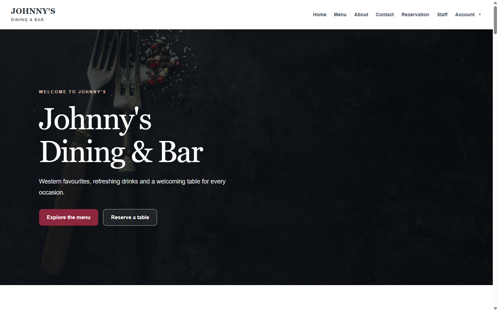
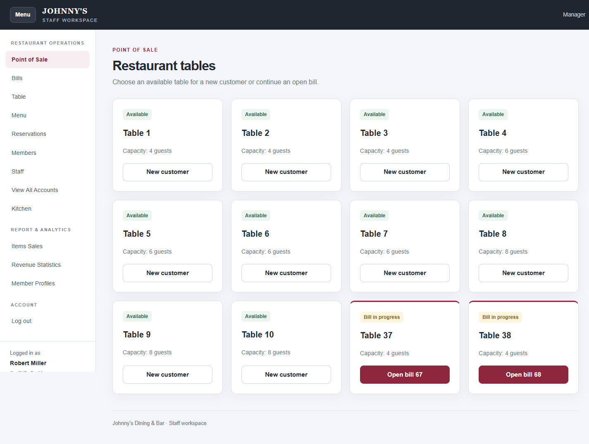

# restoProject

Aplikasi restoran berbasis PHP dan MySQL untuk website pelanggan, reservasi, POS, dapur, pembayaran, serta laporan.

## Fitur

- Pelanggan: registrasi, login, profil, poin, dan reservasi meja.
- Waiter dan Chef: POS, pesanan dapur, reservasi, pembayaran, dan struk PDF.
- Manager: akun, staf, member, meja, menu, statistik, serta laporan PDF.
- Tampilan responsif untuk ponsel, tablet, dan desktop.

Mata uang RM, pajak 10%, zona waktu Asia/Kuala_Lumpur. Pembayaran kartu merupakan simulasi pencatatan; tidak terhubung ke bank atau payment gateway.

## Teknologi

PHP 8.3, MySQL 8.0, Apache 2.4, HTML, CSS, JavaScript, dan FPDF 1.86.

## Screenshot

[Buka galeri lengkap: 57 screenshot halaman desktop, formulir, status, dan PDF](docs/SCREENSHOTS.md).

Screenshot memakai data contoh dari sesi validasi. Halaman alias menggunakan tampilan yang sama. Endpoint penyimpanan dan pengalihan tidak memiliki antarmuka terpisah.

## Lisensi dan kredit

[Apache License 2.0](LICENSE). Dikembangkan dari [RestaurantProject](https://github.com/BryanTheLai/RestaurantProject) oleh Bryan, Yong, Kevin, Edzer, dan kontributor. Lihat [NOTICE](NOTICE) serta [lisensi FPDF](adminSide/posBackend/fpdf186/license.txt).
